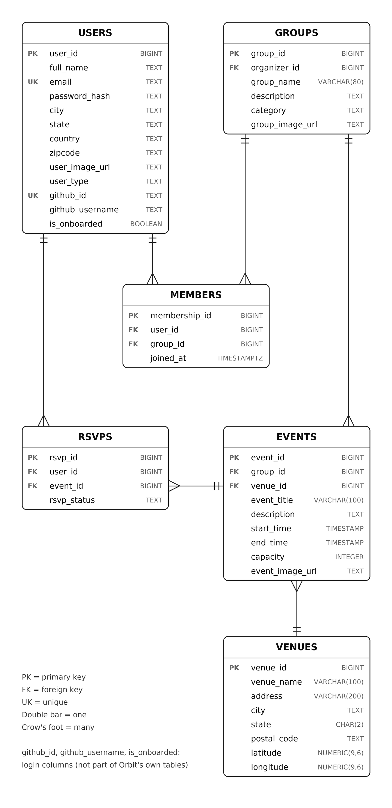
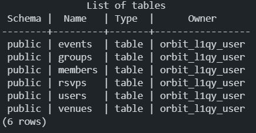
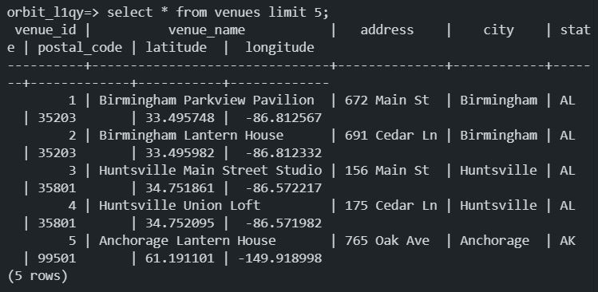
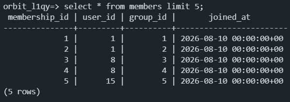
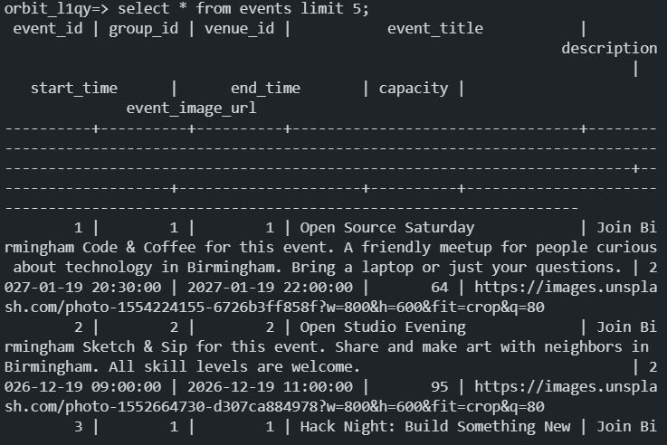
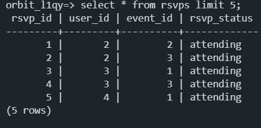

# ORBIT

CodePath WEB103 Final Project

Designed and developed by: Annie Gomez, My Pham, Manav Kothari

Deployment: not available yet.

## About

### Description and Purpose

Our application, Orbit, is intended to provide a platform where users can share information and details about in-person and online events in their area.

Orbit intends to provide a localized platform where residents can easily find nearby events and gatherings, without needing to ask or know anyone in advance.

### Inspiration

We were inspired by the Meetup application, since we enjoyed the diversity in events and usability it brings to users.

## Tech Stack

Frontend: React 19 with Vite and React Router, Leaflet (OpenStreetMap) for the map

Backend: Express, Render PostgreSQL database, GitHub login with Passport

Testing: Vitest and Testing Library (client), Node's built-in test runner (server)

## Features

Feature GIFs have not been recorded yet.

### ✅ Database and API

The PostgreSQL database is configured through the server and contains six tables: `users`, `venues`, `groups`, `members`, `events`, and `rsvps`, as shown in the [entity relationship diagram](planning/ERD.png). Users host groups, groups hold events at venues, and users join groups (`members`) and RSVP to events (`rsvps`).

The database is seeded with data covering all 50 states plus Washington, DC: 749 users, 214 venues, 214 groups, 1,627 memberships, 321 events, and 1,284 RSVPs. The records live in `server/data`, one file per table. To create the tables and load the data, run `npm run db:setup` from the `server` folder.

The Express API provides a root status response, a database health check, and endpoints for users, groups, venues, events, RSVPs, map pins, cities, and categories. Event, RSVP, group, and user queries join the tables so each response includes the related group, venue, and host details. Every endpoint, with its access rules, request fields, and real example responses, is documented in the [API documentation](docs/API.md).



The following `psql` screenshots show the tables and sample data:













### ✅ Creating and Hosting

Hosts can create, edit, view, and delete their own events and groups. An event has a title, a description, a start date and time, an end date and time (events can last several days), a capacity, an optional cover image, and a venue. Hosts choose a venue by typing in a dropdown of saved venues, pick **Online** and enter a meeting link in the same box, or add a new venue by typing only a venue name and an address: Orbit looks the address up, shows it on a small map, and fills in the city, state, ZIP code, and map position. Groups and categories can also be added right from the create event form. Hosts get a **+** button in the top bar with a dropdown to create an event or a group (visitors see the same button, which takes them to log in), and the Events and Groups pages each have a Create button above the filters. Attendees cannot create or edit anything, and one host cannot change another host's events or groups.

Every create, join, and attend shows a short confirmation message, and anything that cancels or deletes (stop attending, leave a group, delete an event or group, or cancel a form with unsaved changes) asks "are you sure?" first.

### ✅ Event Gallery

The home page shows a map of upcoming events with one small pin per event. Hovering over a pin shows the event's title, time, and category, and clicking it opens that event. The Events page shows every event as a grid of cards with a start and end time, the place, and how many people are going, split into pages with a choice of 10 to 50 items per page. Groups have their own grid and pages, and each event and group has a details page that anyone can open without logging in. Times are shown with the venue's time zone (for example 6:30 PM CST), and the event page has a live countdown to the exact start time, whichever time zone you are in.

### ✅ Search and Filter Function

The same filter section appears on the home page, the Events page, and the Groups page: search by event or group name, city, state, ZIP code, and category, plus a start and end date and an "upcoming only" switch. Suggestions drop down as you type, but any text can still be searched. Filters, the page, and the page size are kept in the address, so a search can be shared and the back button works.

### ✅ RSVP Events

Logged-in users can attend an event or say they are not attending, and join or leave groups. Hosts are not offered to attend the events they host. The attendee count updates right away and is put back if the server refuses (for example, when the event just filled up). Events have a capacity, so the last place can never be taken by two people at once. Visitors see a Join button that takes them to log in. The host of an event also sees the list of who answered.

### ✅ Profiles

Every person has a profile page showing their name, location, the events they attend or host, and the groups they joined or organize. Your own profile page shows your email and a form to edit your name, location, and photo. People who sign in with GitHub are asked to complete their profile details. Your **My events** (Hosted or Attending) and **My groups** (Organized or Joined) are on the home page, below the map, and on the **My Collection** page in the top bar, with the lists you host and organize first.

Comments, likes, and saved events/collections are not implemented.

## Installation Instructions

You need Node.js and a PostgreSQL database (the project uses a Render PostgreSQL database).

1. **Install the packages** in both folders:

   ```bash
   cd server
   npm install
   cd ../client
   npm install
   ```

2. **Create `server/.env`** (it is ignored by git). It needs these settings:

   | Setting | What it is |
   |---|---|
   | `PGUSER`, `PGPASSWORD`, `PGHOST`, `PGPORT`, `PGDATABASE` | your PostgreSQL connection |
   | `GITHUB_CLIENT_ID`, `GITHUB_CLIENT_SECRET`, `CALLBACK_URL` | your GitHub OAuth app (the callback is `http://localhost:5173/auth/github/callback` locally) |
   | `SESSION_SECRET`, `CLIENT_URL` | the session secret, and the address of the React app (`http://localhost:5173` locally) |
   | `HOST_USER_TYPE` | the user type that means "host" (the sample data uses `host`) |
   | `ATTENDING_RSVP_STATUS` | the RSVP answer that means "going" (the sample data uses `attending`) |
   | `GEOCODER_URL`, `GEOCODER_USER_AGENT`, `GEOCODER_COUNTRY_CODE`, `GEOCODER_TIMEOUT_MS`, `GEOCODER_MIN_GAP_MS` | the address lookup used when a host adds a venue (for example OpenStreetMap's Nominatim at `https://nominatim.openstreetmap.org/search`, country code `us`, and a gap of at least 1000 milliseconds between lookups) |

3. **Create the tables and load the sample data.** This drops and recreates every table, so it also resets the data:

   ```bash
   cd server
   npm run db:setup
   ```

4. **Start the app** in two terminals:

   ```bash
   cd server
   npm run dev      # the API on http://localhost:3000

   cd client
   npm run dev      # the React app on http://localhost:5173
   ```

5. **Run the tests:**

   ```bash
   cd server
   npm test         # unit tests, no database needed
   npm run test:db  # tests every route against the database, in a temporary schema that is removed afterwards

   cd client
   npm test
   ```

The [API documentation](docs/API.md) lists every endpoint.
