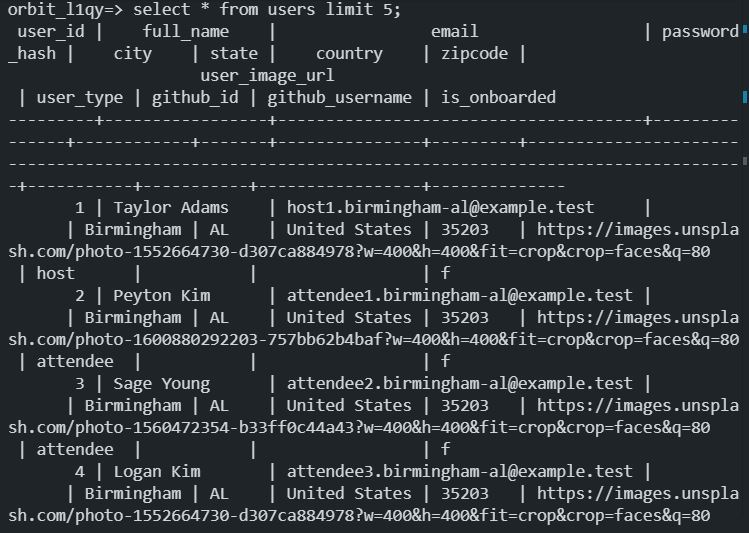
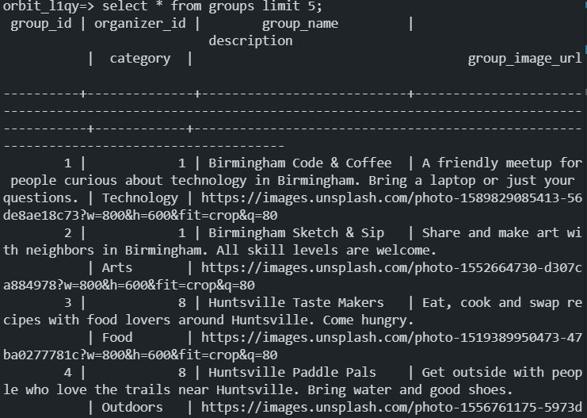

# ORBIT

CodePath WEB103 Final Project

Designed and developed by: Annie Gomez, My Pham, Manav Kothari

🔗 Link to deployed app:

## About

### Description and Purpose

Our application, Orbit, is intended to provide a platform where users can share information and details about in-person and online events in their area.

Orbit intends to provide a localized platform where residents can easily find nearby events and gatherings, without needing to ask or know anyone in advance.

### Inspiration

We were inspired by the Meetup application, since we enjoyed the diversity in events and usability it brings to users.

## Tech Stack

Frontend: React

Backend: Render PostgreSQL database, Express

## Features

### ✅ Database and API

The PostgreSQL database is configured through the server and contains six tables: `users`, `venues`, `groups`, `members`, `events`, and `rsvps`, as shown in the [entity relationship diagram](planning/ERD.png). Users host groups, groups hold events at venues, and users join groups (`members`) and RSVP to events (`rsvps`).

The database is seeded with data covering all 50 states plus Washington, DC: 749 users, 214 venues, 214 groups, 1,627 memberships, 321 events, and 1,284 RSVPs. The records live in `server/data`, one file per table. To create the tables and load the data, run `npm run db:setup` from the `server` folder.

The Express API provides a root status response, a database health check, and endpoints for users, events, and RSVPs. Event, RSVP, and user queries join the tables so each response includes the related group, venue, and host details.

The following `psql` screenshots show the tables and sample data:

### Creating and Hosting

User are able to upload new events to the platform to share with others and to find interested attendees. This includes the ability to create, edit, view, and delete their own posts. The information they are able to upload includes a title, an address, and image, and a description of the event.

### Event Gallery

Users are able to see a list of all local events by city, category or possibly time (such as day or week) in a grid format.

### Search and Filter Function

Users are able to look for events based on title, city, and category of events.

### Collections and Saved Events

Users are able to save events they are interested in into collections or on their own profile.

### RSVP Events

Users are able to indicate if they are attending an event on the event post.

### Comments and Likes

Users are able to like event posts and comment under them to receive more information.

[gif goes here]

## Installation Instructions

[instructions go here]
