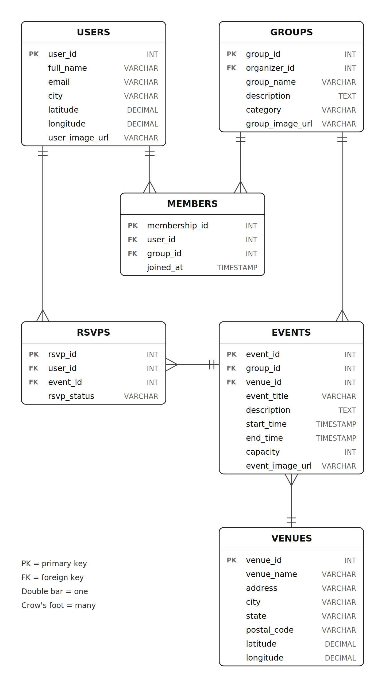

# Entity Relationship Diagram

Reference the Creating an Entity Relationship Diagram final project guide in the course portal for more information about how to complete this deliverable.

## Create the List of Tables

1. USERS

2. GROUPS

3. MEMBERS

4. RSVPS

5. EVENTS

6. VENUES

## Add the Entity Relationship Diagram

