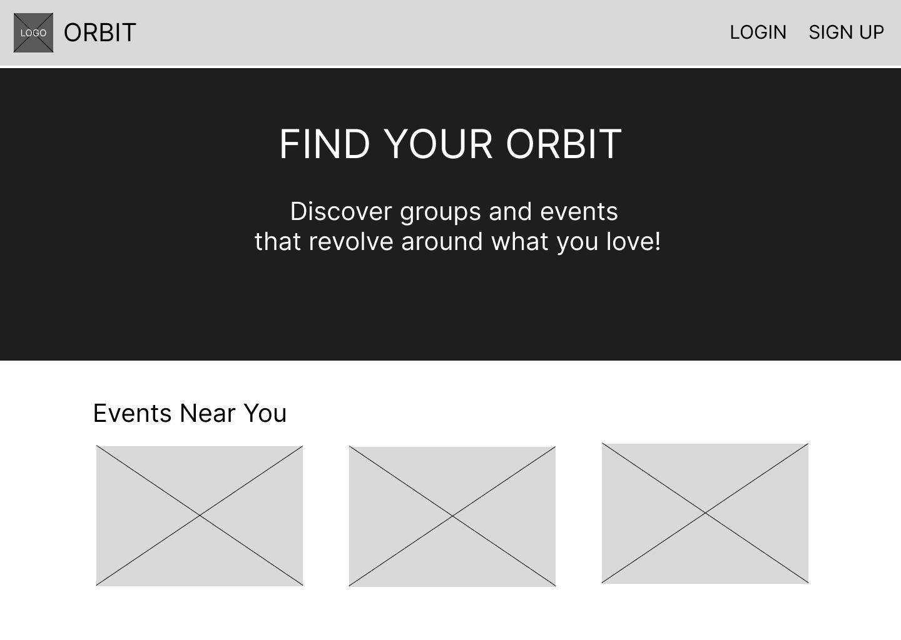
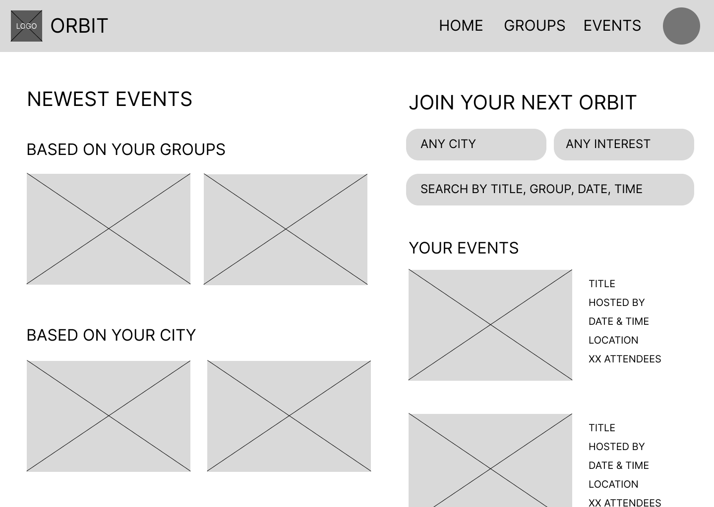
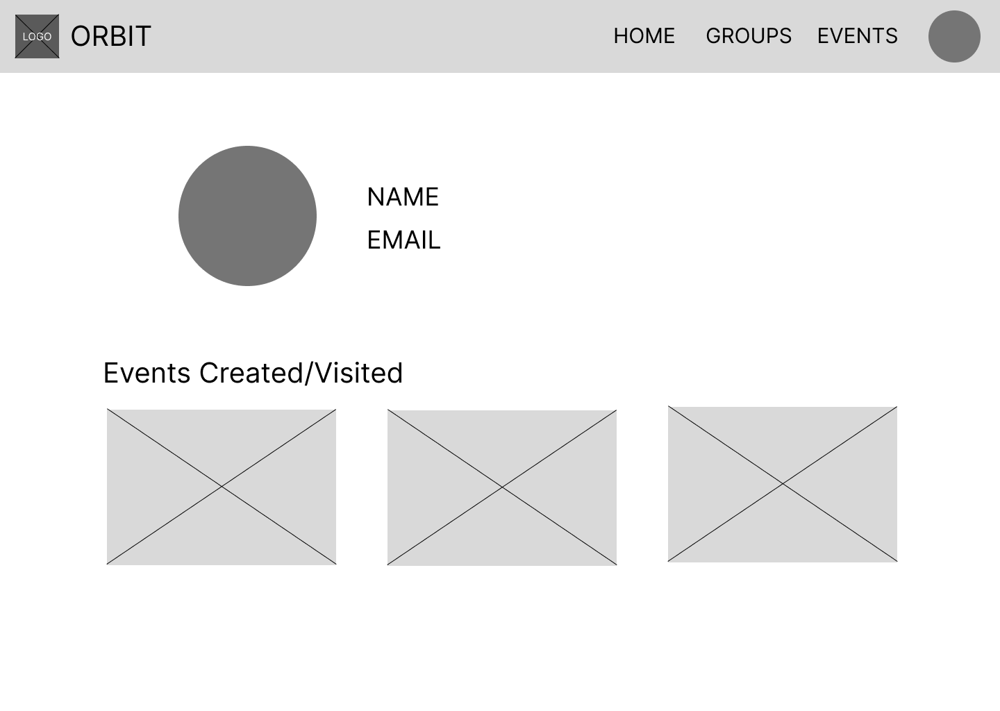
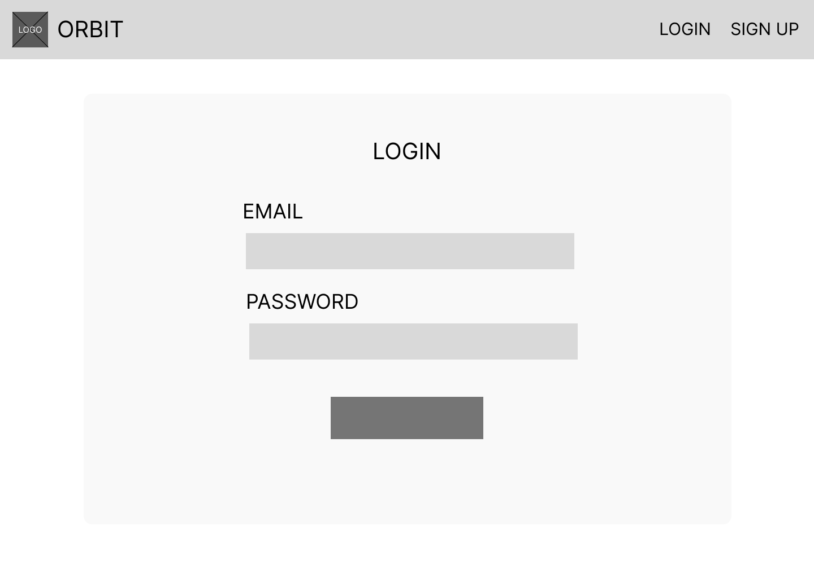

# Wireframes

Reference the Creating an Entity Relationship Diagram final project guide in the course portal for more information about how to complete this deliverable.

## List of Pages

[👉🏾👉🏾👉🏾 List the pages you expect to have in your app, with a ⭐ next to pages you have wireframed]
⭐ Landing  
⭐ Log In  
⭐ Sign Up  
⭐ Home/Gallery  
⭐ Create Post  
⭐ Edit/Delete Post  
⭐ View Post  
⭐ Profile  

## Wireframe 1: Landing

## Wireframe 2: Home/Gallery

## Wireframe 3: Profile

## Our Other Pages:

